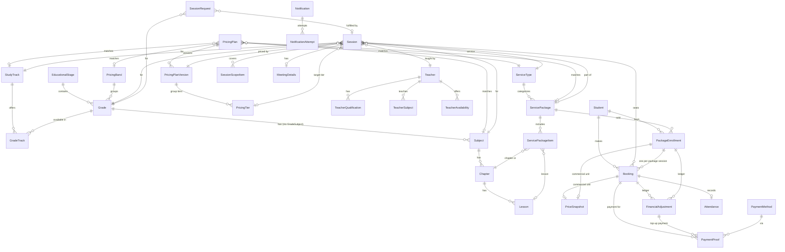

# Dose — Phase 0 Assessment

> Deliverable requested in spec section 21: (1) architecture assessment,
> (2) ERD proposal, (3) unresolved decisions with recommended defaults,
> (4) phased implementation plan.
> Baseline: `docs/Dose_MVP_Specification.md` v1.1. Status: **approved 2026-11-01** — Phase 1 implemented (see section 5).

---

## 1. Architecture assessment

### Current state of the repository

The repository was created from scratch for this project. It contains:

| Path | What it is | State |
|---|---|---|
| `src/Dose.Api` | ASP.NET Core (.NET 10 LTS) host | Health + public-settings endpoints only |
| `src/Dose.Application` | Use cases, one folder per module | Empty module folders |
| `src/Dose.Domain` | Entities, enums, value objects, rules | Empty module folders |
| `src/Dose.Infrastructure` | EF Core, storage, notifications, meetings | Empty |
| `src/Dose.Contracts` | Request/response DTOs shared by API | Empty |
| `src/Dose.Web` | Angular 22, Arabic RTL, brand tokens | Home shell + placeholders |
| `docs/` | Spec, brand, UX identity reference, this file | — |
| `docker-compose.yml` | Local SQL Server 2022 | — |

No business logic, entities, or database exist yet. That is intentional: the spec
requires this assessment to be approved first.

### Proposed architecture

- **Modular monolith**, one deployable API. Modules: Catalog, Pricing, Packages,
  Teachers, Scheduling, Sessions, Bookings, Payments, Notifications, Administration.
  Modules live as folders inside the shared projects (not one project per module) to
  keep the MVP simple; module boundaries are enforced by namespaces and by
  only calling other modules through their application services.
- **Clean layering**: Api → Application → Domain; Infrastructure implements
  Application interfaces. Controllers/endpoints contain no business rules.
- **Persistence**: EF Core 10 + SQL Server / Azure SQL, one `DoseDbContext`,
  migrations in Infrastructure. All timestamps `datetime2` UTC; display in
  `Africa/Cairo` (configurable).
- **Money**: `decimal(12,2)` + ISO currency code (`EGP`) on every amount. A `Money`
  value object in Domain; no floating point.
- **Authentication**:
  - Admin and teacher: ASP.NET Core Identity with secure HTTP-only cookies
    (same-site), role-based policies `Admin`, `Teacher`.
  - Students: no account. Booking access via an unguessable secret link
    (token stored hashed) issued at booking time; OTP can be added when WhatsApp
    Cloud API exists (see decisions D9).
- **Frontend**: one Angular app with lazy-loaded areas: public (student),
  `/admin`, `/teacher` with route guards. Typed API client generated from the
  API's OpenAPI document.
- **Background jobs**: Hangfire (SQL Server storage) for hold/payment expiry, the
  tier-decision job, and reminders. All jobs idempotent; correctness also checked
  inline during booking operations.
- **Files**: `IFileStorage` — local disk in development, Azure Blob (private
  container) in production. Payment screenshots are served only through an
  admin-authorized endpoint.
- **Notifications**: `INotificationProvider`; MVP implementation is
  `ManualWhatsAppProvider` that renders the message text + `wa.me` link for the
  admin to send. Status is `PendingManualSend` until an admin marks it sent —
  never reported as sent automatically.
- **Observability**: structured logging (built-in + JSON console), correlation ID
  middleware, ProblemDetails for all errors.

### Concurrency strategy (last-seat protection)

Seat-taking happens inside one database transaction:

1. `SELECT … FROM Sessions WITH (UPDLOCK, HOLDLOCK) WHERE Id = @id` — serializes
   seat operations per session (other sessions are unaffected).
2. Count bookings that **occupy a seat**: status in
   `PendingHold, PendingPayment, PaymentUnderReview, Confirmed, TopUpPending`
   and (`HoldExpiresAt` is null or in the future).
3. If count < capacity, insert the booking; otherwise return `SessionFull`.

Additionally:

- A **filtered unique index** on `Bookings(SessionId, ContactPhoneE164)` for
  seat-occupying statuses prevents duplicate active bookings at the database level.
- `Sessions.RowVersion` (rowversion) for optimistic concurrency on admin edits.
- Idempotency: `IdempotencyKeys` table (key + endpoint + response hash) for
  "submit details", "submit payment proof", and "approve payment".
- Integration test: N parallel requests for the last seat → exactly one succeeds.

### Pricing resolution

- `PricingPlan` holds the matching dimensions (pricing band, study track,
  subject?, service type, package?, mode) and points to **versions**.
- `PricingPlanVersion` is immutable once any booking has used it; edits create a
  new version. It holds the private price, package price, and group tiers.
- Resolution = all active plans whose dimensions match the context and whose
  effective dates include the session date; **the most specific wins** (count of
  non-null dimensions). Two active plans with equal specificity for the same
  context are rejected at save time, so resolution is always deterministic.
  No match → `PricingNotConfigured` error (never a fallback price).
- A session is bound to a `PricingPlanVersionId` and `TargetTierId` when
  published, so later price edits never affect already-published sessions.

### Risks

| Risk | Mitigation |
|---|---|
| Manual payment review becomes a bottleneck | Review queue sorted by age, SLA indicator, payment-proof deadline configurable |
| Top-up flow erodes trust | Mandatory disclosure + acceptance checkbox, admin waive option |
| Minors' personal data | Minimal fields, admin-only access to screenshots, no PII in URLs, retention policy (decision D12) |
| Scope creep in packages | Packages are data-driven from day one; MVP UI supports one package template shape |

---

## 2. ERD proposal

Simplified for readability (audit columns `CreatedAt/By`, `UpdatedAt/By`,
`IsActive`, `SortOrder` omitted where obvious).

### Key tables and columns

**Catalog**
- `EducationalStage` (Id, NameAr, RequiresGuardianContact)
- `Grade` (Id, StageId, PricingBandId, NameAr, Order)
- `StudyTrack` (Id, NameAr — e.g. عربي / لغات) · `GradeTrack` (GradeId, StudyTrackId, CurriculumSystem?)
- `PricingBand` (Id, NameAr) — grade grouping for pricing only
- `Subject`, `GradeSubject`, `Chapter` (SubjectId, GradeId, StudyTrackId?), `Lesson`

**Services & packages**
- `ServiceType` (Id, Code, NameAr, DescriptionAr, RequiresPackage)
- `ServicePackage` (Id, ServiceTypeId, NameAr, DescriptionAr, GradeId, StudyTrackId, SubjectId, SessionCount, SessionDurationMinutes, ValidityDays?, AllowedModes, MaxReschedules?)
- `ServicePackageItem` (PackageId, ChapterId?, LessonId?)
- `PackageEnrollment` (Id, StudentId, PackageId, Status, TermsSnapshotJson, PriceSnapshotId, ValidUntil?)

**Pricing**
- `PricingPlan` (Id, Name, PricingBandId?, StudyTrackId?, SubjectId?, ServiceTypeId, PackageId?, Mode, Currency, Policy, EffectiveFrom, EffectiveTo?)
- `PricingPlanVersion` (Id, PlanId, VersionNo, PrivatePrice?, PackagePrice?, IsLocked)
- `PricingTier` (Id, VersionId, NameAr, MinParticipants, MaxParticipants, PricePerStudent, Order)
- `PriceSnapshot` (Id, PlanId, VersionId, Currency, BasePrice, TargetTierId?, TierMin?, TierMax?, WorstCasePrice?, FinalAmount, Policy, CalculatedAt) — insert-only
- `FinancialAdjustment` (Id, BookingId? | EnrollmentId?, Type [TopUpDue, TopUpReversed, Waiver, Refund, Transfer], Amount, Currency, Status, Reason, CreatedBy, CreatedAt) — insert-only ledger

**Delivery**
- `Teacher` (Id, UserId, DisplayNameAr, PhotoUrl, BioAr, YearsExperience, IsPublished)
- `TeacherQualification`, `TeacherSubject` (TeacherId, SubjectId, GradeId?), `TeacherAvailability` (TeacherId, StartUtc, EndUtc, Status [Submitted, Approved, Rejected])
- `Session` (Id, ServiceTypeId, PackageId?, GradeId, StudyTrackId, SubjectId, TeacherId, StartUtc, EndUtc, Mode, Capacity, MinParticipants, PricingPlanVersionId, TargetTierId?, Policy, BookingDeadlineUtc, TierDecisionAtUtc?, Status, RowVersion)
- `SessionScopeItem` (SessionId, ChapterId?, LessonId?, ScopeNoteAr?)
- `MeetingDetails` (SessionId, Provider, Url) — never returned by public endpoints
- `SessionRequest` (Id, StudentName, ContactPhoneE164, GuardianName?, GuardianPhoneE164?, GradeId, StudyTrackId, SubjectId, ServiceTypeId, ScopeText, PreferredWindowsJson, Mode, PreferredTierId?, Notes, Status, FulfilledBySessionId?)

**Bookings & payments**
- `Student` (Id, NameAr, ContactPhoneE164, GuardianName?, GuardianPhoneE164?) — created per booking contact; no login
- `Booking` (Id, Reference [e.g. DS-7K3Q9P], SessionId, StudentId, PackageEnrollmentId?, Status, HoldExpiresAt?, PaymentDueAt?, PriceSnapshotId?, TermsAcceptedAt, TopUpTermsAcceptedAt?, AccessTokenHash, ContactPhoneE164 (denormalized for the unique index), RowVersion)
- `PaymentMethod` (Id, Code [InstaPay, VodafoneCash], NameAr, ReceivingAccount, InstructionsAr, IsActive) — admin-managed
- `PaymentProof` (Id, BookingId?, AdjustmentId?, PaymentMethodId, Amount, SenderRef?, FileKey, Channel [Platform, WhatsApp], Status [Submitted, Approved, Rejected], ReviewedBy?, ReviewedAt?, RejectionReason?)
- `Attendance` (BookingId, Status [Attended, Absent], MarkedBy, MarkedAt)

**Operations**
- `Notification` (Id, Channel, TemplateCode, RecipientPhoneE164, BodyAr, RelatedBookingId?, Status [PendingManualSend, Sent, Failed]) · `NotificationAttempt`
- `AuditLog` (Id, ActorId, Entity, EntityId, Action, BeforeJson, AfterJson, At)
- `SystemSetting` (Key, Value, UpdatedBy, UpdatedAt) — hold duration, proof deadline, tier decision offset, etc.
- `IdempotencyKey` (Key, Endpoint, ResponseHash, CreatedAt)

### How packages consume seats

A package enrollment creates **one `Booking` per included session** (amount 0 on the
booking, `PackageEnrollmentId` set). The single `PriceSnapshot` and all adjustments
live on the `PackageEnrollment`. All seat bookings are taken in one transaction —
if any included session is full, the whole enrollment fails. This keeps capacity
logic identical for single lessons and packages.

---

## 3. Unresolved decisions — recommended defaults

All values below become `SystemSetting` / pricing data, so they can change without code.

| # | Decision | Recommended default |
|---|---|---|
| D1 | Production prices per band/track/service/tier | Seed with sample prices clearly marked `SAMPLE — NOT PRODUCTION` until provided |
| D2 | Arabic vs Languages pricing | Model supports both; default: same price (one plan with null track) |
| D3 | Session duration per service | One lesson 60 min, chapter session 90 min, revision 120 min (configurable per package/session) |
| D4 | Group size options | 2–4, 5–9, 10–15 (spec example), max capacity 15 |
| D5 | Tier decision deadline | 24 h before start; student response window 6 h; booking deadline = tier decision time |
| D6 | No response to top-up request | Booking stays `TopUpPending`; admin decides; never auto-charge |
| D7 | Seat hold / payment-proof deadline | **Approved: dynamic.** Admin-editable in Settings (defaults: hold 15 min, proof 60 min, resubmit 60 min, join opens 15 min before start) |
| D8 | Cancellation & refunds | **Approved:** full refund if student cancels ≥ 24 h before start; no refund after; full refund always when Dose cancels |
| D9 | Booking lookup security | **Approved:** secret link `/b/<token>` (256-bit random token, only its SHA-256 hash stored). The student opens the link on the Dose platform and joins the session from there; the Meet URL is never sent in messages and is revealed only to confirmed bookings inside the join window |
| D10 | Refund method | Same method and number the student paid from; manual by admin, recorded as adjustment |
| D11 | Teacher availability | Teachers submit, admin approves |
| D12 | Data retention | Payment screenshots deleted 180 days after session completion; booking data kept for accounting |
| D13 | Teacher ratings display | Hidden until a teacher has ≥ 5 real reviews |
| D14 | Package with group mode | Package price follows the same target-tier model as single group sessions |

---

## 4. Phased implementation plan

Each phase ends with: build, tests, migration list, and a short report.

### Phase 1 — Vertical slice (first priority)

Goal: one group session can be booked and confirmed end to end.

1. Domain + EF configuration for catalog (stage, grade, track, subject, chapter,
   lesson), service types, pricing plan/version/tier, teacher, session, student,
   booking, price snapshot, payment method, payment proof, system settings.
2. Initial migration + development seed (sample catalog, one teacher, sample prices
   labelled non-production).
3. Pricing service: private price, target-tier price, worst-case price; unit tests
   (boundaries, missing plan, overlapping tiers, equal-specificity conflict).
4. Booking: hold → details (guardian rule) → payment proof upload → admin approve →
   `Confirmed` + snapshot. Inline expiry check.
5. Integration tests: last-seat race, duplicate booking, expired hold release.
6. Minimal admin: login + payment review queue.
7. Student UI: home selectors (from catalog API), session list, session details
   (teacher + group terms), booking form, payment step, booking status page.

### Phase 2 — Admin configuration

Catalog CRUD, pricing plan/tier editor with validation, package builder, teacher
management, session create/publish with target tier, settings screen, audit log.

### Phase 3 — Group lifecycle & packages

Tier decision job (Hangfire), top-up / transfer / refund flow, financial
adjustments ledger, package enrollment across multiple sessions, open-groups page,
session requests (student form + admin list).

### Phase 4 — Teacher area & operations

Teacher login, availability submission + admin approval, assigned sessions,
meeting link management, attendance, manual WhatsApp message templates
(copy / open chat), notification log, reminders job.

### Phase 5 — Hardening & deployment

Rate limiting, security review, PWA, accessibility pass, Azure deployment
(App Service + Azure SQL + Blob), setup/runbook docs.

---

## 5. Phase 1 — delivered

| Area | What works |
|---|---|
| Catalog API | Stages → grades, study tracks, subjects per grade, service types, payment methods |
| Sessions API | List with filters, open groups, details with teacher + group terms (target tier, worst case, max extra) |
| Booking | Hold (seat locked per session) → details (guardian rule, terms, price re-check, duplicate-number index) → payment proof upload (image sniffing, size limit, private storage) |
| Admin | Cookie login (Identity), payment review queue with screenshot, approve (idempotent, creates price snapshot, locks pricing version) / reject with reason, editable settings |
| Secret link | `/b/<token>` page drives the whole journey; "Join" button calls the API for the Meet link only inside the join window |
| Web | Arabic RTL screens: home selectors, sessions, open groups, details, booking steps, payment, confirmation, admin |
| Tests | 65 passing: pricing/tier rules, phone normalization, tokens, file sniffing, and SQL Server integration tests incl. 25 concurrent holds on a 4-seat session and a 10-way last-seat race |

Not yet (planned): session request form (Phase 3), tier-decision job & top-up flow (Phase 3), admin CRUD for catalog/pricing/sessions/teachers (Phase 2), teacher area (Phase 4), cancellation policy values as settings (Phase 3 — the policy text is currently fixed in the UI).

## 6. Phase 2 — delivered

| Area | What works |
|---|---|
| Catalog | Stages (guardian rule), grades (stage, pricing band, curriculum system, subjects taught), study tracks, pricing bands, subjects, chapters & lessons, service type names/descriptions. Deactivate instead of delete. |
| Teachers | Name, photo URL, qualifications, bio, experience, published flag (a session can only be published with a published teacher) |
| Payment methods | Name, code, receiving account, instructions, active flag |
| Pricing | Plans by service type × mode × (band / track / subject) × dates; conflict detection; private price + group tiers with validation. A version used by any session is locked — saving creates a new version, existing sessions and bookings keep their prices |
| Sessions | Create with live pricing preview and group-size choice; deadlines from settings; save as draft / publish; edit (only time, teacher, title and Meet link once bookings exist); cancel (unpaid bookings cancelled, paid ones → refund pending); bookings list; issue a new secret link and copy a ready WhatsApp message |
| Audit | Every admin change is written to the audit log |
| Tests | 70 passing (5 new admin integration tests) + browser walkthrough of the admin flow |

Still planned: teacher photo upload (URL for now), session requests (Phase 3), tier-decision job and top-up/refund workflow (Phase 3), teacher area (Phase 4).

## 7. Phase 3 — delivered

| Area | What works |
|---|---|
| Session requests | Public form (grade, subject, track, service, scope, preferred days/times, private or group size with indicative prices, guardian rule). Admin list by status, WhatsApp chat, "create session from request" (pre-filled; request marked fulfilled on save) |
| Group decision | Hangfire job every 5 minutes decides due group sessions (admin can also "decide now"). Target reached → session confirmed. Not reached → each confirmed student gets a top-up entry (difference to the tier of the actual count, or the private price if alone) and a response deadline |
| Student choice | On the private booking page: pay the difference (upload proof), move to another date, or full refund. Nothing is charged without the student's choice |
| Fairness rules | The count used for pricing never drops below the count at decision time, so students who opt out never raise what others owe. A late payment approval re-calculates and can only lower top-ups (cancelled when the target is reached) |
| Ledger | Top-ups, waivers and refunds are separate ledger entries; amounts are never edited — recalculation cancels and re-issues. Price snapshots untouched |
| Admin follow-ups | One page for top-ups (waive), refunds (mark transferred back), transfers (mark arranged), with ready WhatsApp messages; top-up proofs appear in the payments queue tagged "فرق جروب" |
| Cancellation | Student can cancel from the booking page: unpaid → seat released; paid and early enough (admin setting, default 24h) → refund pending; later → only with explicit "no refund" acceptance |
| Jobs | Hangfire (SQL Server storage): tier decisions every 5 min, expire stale holds every 10 min. Disable with `Jobs__Enabled=false` |
| Tests | 76 passing (6 new Phase 3 integration tests) + browser walkthrough of the full request → booking → decision → top-up → refund flow |

Next (Phase 4): teacher area (login, availability, assigned sessions, attendance), notification log with message templates.

## 8. Phase 4 — delivered

| Area | What works |
|---|---|
| Team login | One login page (`/login`) for admins and teachers; each is sent to their own area. Students still need no account |
| Admin dashboard | Home page with what needs attention (payment proofs and the oldest one's age, open/overdue top-ups, refunds, transfers, new requests, availability to approve), sessions in the next 48h (fill and missing Meet links), groups close to their decision (count vs minimum), and last-30-day numbers (confirmed bookings, collected incl. top-ups, refunds) |
| User management | Create admin/teacher accounts (teacher accounts linked to a teacher profile), reset password, disable/enable, re-link profile. Safeguards: no self-disable, the last active admin can't be disabled; disabling ends sessions within a minute |
| Teacher area | "My sessions" (upcoming/past, counts, what needs attendance), session page with the Meet link and **first names only** (no phone numbers), attendance from 15 min before start until 48h after end, "end session" (attended → Completed, absent → NoShow) |
| Availability | Teachers submit time windows (no overlaps, future only), admins approve/reject with a note, teachers can withdraw |
| Tests | 80 passing (4 new Phase 4 integration tests incl. user safeguards) + browser walkthrough (admin creates teacher account → teacher logs in → availability → admin approves; teacher blocked from admin pages) |

Not yet: notification log with message templates; teacher photo upload; deployment (Phase 5).

## 9. Arabic + English, WhatsApp messages, teacher photos — delivered

| Area | What works |
|---|---|
| Two languages | Every screen (student, teacher, admin) in Arabic (RTL) and English (LTR). Language button in the header; the choice is remembered on the device. Default follows the browser (Arabic unless the browser is English) |
| Where texts live | **Interface texts** in the frontend: `src/Dose.Web/i18n-src/*.json` (Arabic and English side by side; `python3 i18n-src/build.py` regenerates `src/app/i18n/ar.ts`/`en.ts`; `python3 i18n-src/check.py` fails if a key used in the app is missing). The English dictionary is type-checked against the Arabic one, so a missing translation fails the build. **Content** (catalog, teachers, payment methods, tiers, session titles, message templates) comes from the database with optional English fields — empty English falls back to Arabic. **Errors**: the API returns a stable `code` plus a title already in the request's language (`Accept-Language`); the frontend shows it and words only connection-level failures itself |
| Design | Direction-aware layout (logical CSS properties; step markers, back arrows and form fields flip with the language), mixed Arabic/English content uses `dir="auto"`, numbers use Latin digits in both languages, dates and amounts are formatted per language (`ج.م` / `EGP`) |
| Admin English fields | Catalog (stages, grades, tracks, bands, subjects, units, lessons, service types + descriptions), teachers (name, qualifications, bio), payment methods (name, instructions), pricing tiers, session title and details |
| WhatsApp messages | New **Messages** page: events (payment approved/rejected, top-up needed, refund sent, session cancelled, request received, 3-hour reminders) queue a message in the language the student booked in. The admin opens it ("Prepare" fills the secret link — never stored in the log), copies it, opens the student's or parent's chat, and marks it sent or skips it. Sent/skipped tabs are the log. Dashboard tile shows messages waiting |
| Templates | Editable Arabic + English text per message type with the allowed placeholders listed; unknown placeholders are rejected; a template can be switched off |
| Teacher photo | Upload/replace/remove from the teacher card (JPG/PNG/WebP up to 2 MB, content checked, stored privately). Served publicly only for published teachers, with a versioned URL |
| Follow-up messages | Messages written from the Follow-ups page use the student's booking language, not the admin's |
| Development data | English names for the SAMPLE catalog are filled in development only, so the English site can be previewed |
| Tests | 88 backend tests passing (messages, templates, photo validation, language fallback, follow-up language) + browser walkthrough in both languages (English and Arabic bookings, admin approval, Messages compose with link, templates, photo upload, language switch) |

Admin-only lists (payments, follow-ups, requests, dashboard) show content names in Arabic as entered; the admin interface itself is translated.
Not yet: optional admin page to override interface texts; Phase 5 (hardening, PWA, Azure deployment).

